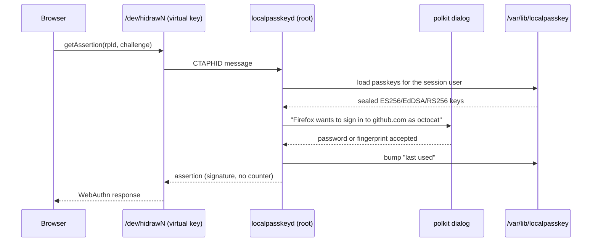

# LocalPasskey

LocalPasskey turns a Debian computer into a passkey (FIDO2/WebAuthn)
authenticator, much like Windows Hello does on Windows. Websites can create
passkeys that live on this machine, and you confirm every registration and
sign-in in a system dialog. No TPM, biometric sensor or hardware security key
is needed.


## How it works

```
 browser ──CTAP2 over HID──▶ /dev/hidrawN ◀──/dev/uhid── localpasskeyd (root, systemd)
 (Firefox, Chrome, ...)       virtual USB key              │  ├─ passkeys: /var/lib/localpasskey
                                                           │  └─ "is this really you?" ──▶ polkit
 localpasskey (CLI) ──────────── /run/localpasskey/control.sock          │
                                                                        ▼
                                      authentication dialog in your desktop session
```

* `localpasskeyd` runs as a system service and creates a **virtual USB
  security key** through the kernel's uhid driver. Linux browsers have no
  platform-authenticator API, but all of them support USB security keys, so
  this works with Firefox, Chromium/Chrome/Brave/Edge, and libfido2 tools
  (`fido2-token`, `ssh-keygen -t ed25519-sk`) without any browser extension.
* systemd's `fido_id` udev rules recognise the device as a FIDO token and give
  the user at the active desktop session access to it, as with real keys.
* The authenticator speaks CTAP 2.0 and advertises **built-in user
  verification**, the way a fingerprint key does. Before a passkey is created
  or used, the daemon asks **polkit**, which shows your desktop's
  authentication dialog with the site and account, for example *"Firefox wants
  to sign in to github.com as "octocat" with a passkey stored on this
  computer."* You confirm with your own password, or with a fingerprint if PAM
  is set up for fprintd.
* Passkeys are **per Linux user**. The daemon works out who is asking from the
  process that opened the device. Each user can have any number of passkeys,
  including several accounts on the same site; for user-name-less sign-ins the
  browser shows an account chooser.
* Keys are ES256 (P-256), EdDSA (Ed25519) or RS256, whichever the site prefers.
  Attestation is `none`.

### A sign-in, end to end



Registration follows the same path, except the daemon *generates* the key
instead of loading one, seals it under `master.key`, and writes it to the
store. The polkit dialog appears in both cases; nothing is signed without it.

### Where the code lives

```text
localpasskey/
├── ctaphid.py    # CTAPHID framing — the USB transport layer
├── ctap2.py      # CTAP2 commands: makeCredential, getAssertion, the Verdict decisions
├── cbor.py       # CBOR encode/decode used by both layers above
├── cose.py       # key generation and COSE key encoding (ES256 / EdDSA / RS256)
├── uhid.py       # creates the virtual USB device via /dev/uhid
├── daemon.py     # the root service: owns the device, routes requests
├── session.py    # maps a request to the Linux user who sent it
├── polkit.py     # asks for confirmation; the trust boundary
├── store.py      # per-user passkeys on disk, sealed with AES-256-GCM
├── clientpin.py  # the CTAP2 PIN/UV protocols and the PIN browsers set
├── control.py    # the control socket the CLI and window talk to
├── cli.py        # the `localpasskey` commands: list, delete, restore, purge, pin
└── gui.py        # the Qt window
```

## Build and install

```sh
sudo apt install debhelper dh-python python3-cryptography python3-gi python3-fido2 \
    python3-pyqt6 python3-qdarkstyle
make deb                      # runs the test suite, then builds both packages into dist/
sudo apt install ./dist/localpasskey_0.2.0_all.deb ./dist/localpasskey-gui_0.2.0_all.deb
```

`localpasskey` is the service and command-line tool. `localpasskey-gui` is
the optional window, built with Qt 6 and the QDarkStyle theme that Electrum and
Feather Wallet use.

The package enables and starts `localpasskey.service`. Check it with:

```sh
localpasskey status
fido2-token -L                # from fido2-tools; shows the virtual key
```

Then register a passkey on any site that supports them (for example
<https://webauthn.io>). In the browser's dialog, pick the USB security key
option if it asks.

## Managing passkeys

Open **LocalPasskey** from the applications menu (or run `localpasskey-gui`).
The window lists your passkeys by website, account and last use; click a column
header to sort, or type in the search field (Ctrl+F). Selecting a passkey shows
its details, with buttons to copy the username, open the website or move it to
the trash; the same actions are in the Passkey menu and on right-click. New
passkeys appear within a few seconds of creating them in a browser.

The same is available from a terminal:

```sh
localpasskey list                     # your passkeys
localpasskey delete 3f9a1c2d          # by ID (or unique prefix) from `list`
localpasskey delete --site github.com
localpasskey list --trash             # what is in the trash
localpasskey restore 3f9a1c2d         # bring a passkey back
localpasskey purge 3f9a1c2d           # delete one for good
sudo localpasskey list --user alice   # root can manage anyone's
```

Deleting asks for your password through polkit; over SSH, the command starts
`pkttyagent` so you can answer in the terminal. Remove the passkey from the
website's account settings as well.

`delete` moves a passkey to the **trash** instead of destroying it: it stops
working at once, in every browser, but `list --trash` still shows it and
`restore` brings it back. Nothing in the trash expires; `purge` deletes one
passkey permanently and asks you to type the site name first. Restoring is
refused while a newer passkey for the same account on the same site exists,
since the site would then have two live passkey IDs for one account; delete
the newer one first.

A **PIN** is a second lock on the stored passkeys, the one browsers ask for in
their security-key settings before they list or delete anything. Set one with
`localpasskey pin set`, look at it with `localpasskey pin status` (which also
shows how many attempts are left), and drop it with `localpasskey pin remove`.
Only a hash is stored, and the PIN alone never deletes a passkey: every change
still asks for your password.

In the window, *View → Show Trash* (Ctrl+T) switches the list to the trash,
with restore and permanent deletion there; the Passkey menu also moves all
passkeys for a website, or all of them, at once; and *File → Security Key PIN…*
sets or removes the PIN.

## Security model

* Private keys never leave the root-only directory `/var/lib/localpasskey`.
  They are also sealed with AES-256-GCM under `master.key`, and each sealed
  key is bound to its owner's uid. Processes running as you can *ask* to use a
  passkey but cannot copy one, and every use needs your password in the
  dialog.
* Websites learn nothing that identifies this computer or this software. Every
  passkey has its own random key and ID, the AAGUID (authenticator model ID) is
  all zeros, and the signature counter is always 0. A moving counter would let
  a site link several accounts you hold there, because the account chooser
  signs for all of them.
* Passkeys are device-bound: no sync, no cloud. Back up
  `/var/lib/localpasskey` (including `master.key`) if you need to, and keep the
  backup safe; whoever has it can use the passkeys.
* The polkit action `org.localpasskey.authenticate` defaults to `auth_self`.
  Never relax it to `yes` in a polkit rule: any website could then use your
  passkeys silently.
* Requests are refused when the browser doesn't run in the active local session,
  or when the daemon can't tell which user sent them.

## Configuration

`/etc/localpasskey/localpasskeyd.conf` sets the dialog timeout, desktop
notifications, the log level, and the USB IDs of the virtual key.

LocalPasskey shows a desktop notification when a passkey is saved, used to sign
in, moved to the trash or permanently deleted, so you notice any use you didn't
expect. It also shows one when a request is declined, times out or fails, when
a site asks for a passkey this computer doesn't have, and when no confirmation
dialog can be shown. Set `activity_notifications = no` to keep only the problem
notifications, or `notifications = no` to turn them all off. Restart the
service after changes. Logs: `journalctl -u localpasskey`.

## Troubleshooting

* **No dialog appears / "Passkey request blocked" notification:** a polkit
  authentication agent must run in your session. GNOME, KDE, MATE, Cinnamon,
  LXQt and Xfce set this up. On bare window managers, start one such as
  `lxpolkit` or `/usr/lib/policykit-1-gnome/polkit-gnome-authentication-agent-1`.
* **Browser doesn't see the key:** run `fido2-token -L` and `getfacl
  /dev/hidraw*`; your user needs an ACL entry on the LocalPasskey device.
  Snap-packaged browsers only allow USB IDs from their `u2f-devices`
  allow-list; set `vendor_id`/`product_id` accordingly, or use a deb or
  Flatpak browser.
* **The browser keeps saying "touch your security key":** the site asked for a
  passkey this computer doesn't have; a desktop notification says so. LocalPasskey
  then behaves like an untouched security key, so a hardware key you plug in or
  touch can still answer. Cancel in the browser to give up.
* **Using a hardware key as well:** touch the hardware key when the LocalPasskey
  dialog appears; the dialog closes by itself. Clicking *Cancel* in the dialog
  ends the whole request.

## Limitations

* Sites that only offer passkeys when the browser reports a *platform*
  authenticator (`authenticatorAttachment: "platform"`) won't route requests
  here. Linux browsers don't have a platform authenticator API to plug into.
* The `prf`/`hmac-secret`, `largeBlob` and `credBlob` extensions are not
  implemented. For mainstream sites this goes unnoticed: CTAP2 says an
  authenticator must ignore an extension it doesn't know, so registering and
  signing in work anyway. The one requirement we know of is Bitwarden's
  passkey unlock (and its encrypted login), which needs `prf`; signing in to
  Bitwarden with a passkey still works. `largeBlob` only fails where a site
  insists on it, `credBlob` is used by no mainstream site, and OpenSSH uses
  neither.
* Passkeys can be listed and deleted from the browser's security-key settings:
  in Chrome, `chrome://settings/securityKeys` → *Sign-in data* shows them all
  once a PIN is set. Set it first with `localpasskey pin set` or the window's
  *Security Key PIN* dialog: with no PIN yet, Chrome's page offers to create one
  and cannot, because the key does not advertise PIN support until one exists.
  Chrome can change an existing PIN there. Deleting a passkey moves it to the
  LocalPasskey trash rather than erasing it. Chrome does not offer renaming,
  because the key reports CTAP 2.0. `ssh-keygen -K` and `ssh-add -K` download
  resident SSH keys the same way and need the PIN too. Firefox has no such
  settings page.
* Browser settings still can't reset the key: `authenticatorReset` is refused
  on purpose. Use `localpasskey delete` or the window instead. A site's own
  "delete passkey" button (the WebAuthn Signal API) does not reach security
  keys on Linux, so remove the passkeys you no longer need here.

## Development

```sh
make check                                # unit, mock, socket/CLI and offscreen GUI tests
sudo python3 -m tests.e2e_isolated --user "$USER"  # temporary real HID device; cleans up
sudo ./bin/localpasskeyd --debug --state-dir /tmp/lpk --socket /tmp/lpk.sock
python3 -m tests.e2e_device               # real round trip over /dev/hidraw
python3 tests/browser/serve.py            # test page for browsers at http://localhost:8765/
python3 -m tests.gui_demo                 # the window with sample passkeys, no service needed
```

The tests drive the authenticator through python-fido2's CTAPHID host code
and its `Fido2Client`/`Fido2Server`, so both the wire format and the WebAuthn
results are checked by an independent implementation.

`tests.e2e_isolated` runs a separate source daemon with temporary storage and
an unprivileged client in the active desktop session. It checks real kernel HID
registration, signatures, denial, cancellation, persistence after restart, and
CLI deletion. Only its password-verification decision is mocked, inside that
test daemon; it does not change system polkit rules or existing passkeys.

For browser checks, start the test page and a disposable, visible Firefox or
Chromium profile with remote debugging enabled. With that browser focused:

```sh
python3 -m tests.browser.check firefox --port 9233
python3 -m tests.browser.check chromium --port 9234
```

The checker uses `websocket-client` (`python3-websocket` on Debian) and verifies
registration and assertion signatures for ES256, Ed25519 and RS256. It uses
the browser's real USB authenticator selection and creates three test accounts
per browser on `localhost`; use an isolated authenticator/storage for these
checks. Real password or fingerprint acceptance still requires an interactive
polkit check. The checks do not constitute FIDO certification.
