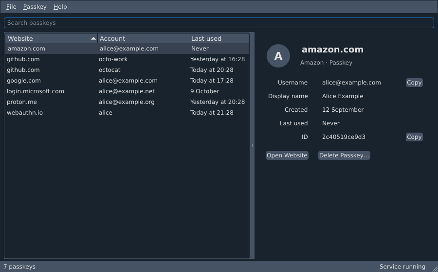
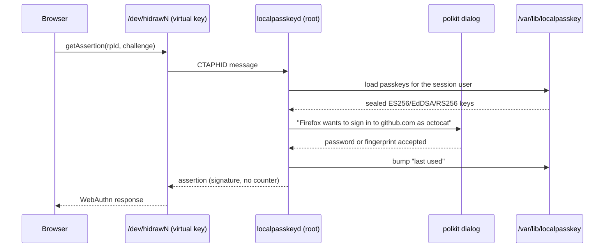

# LocalPasskey

LocalPasskey turns a Debian computer into a passkey (FIDO2/WebAuthn)
authenticator, much like Windows Hello does on Windows. Websites can create
passkeys that live on this machine, and you confirm every registration and
sign-in in a system dialog. No TPM, biometric sensor or hardware security key
is needed.



## How it works

```
 browser ──CTAP2 over HID──▶ /dev/hidrawN ◀──/dev/uhid── localpasskeyd (root, systemd)
 (Firefox, Chrome, ...)       virtual USB key              │  ├─ passkeys: /var/lib/localpasskey
                                                           │  └─ "is this really you?" ──▶ polkit
 localpasskey (CLI) ──────────── /run/localpasskey/control.sock          │
                                                                        ▼
                                      authentication dialog in your desktop session
```

* `localpasskeyd` runs as a system service and creates a **virtual USB
  security key** through the kernel's uhid driver. Linux browsers have no
  platform-authenticator API, but all of them support USB security keys, so
  this works with Firefox, Chromium/Chrome/Brave/Edge, and libfido2 tools
  (`fido2-token`, `ssh-keygen -t ed25519-sk`) without any browser extension.
  An optional extension for Chrome and Chromium also makes LocalPasskey the
  browser's passkey authenticator "on this device" (see below).
* systemd's `fido_id` udev rules recognise the device as a FIDO token and give
  the user at the active desktop session access to it, as with real keys.
* The authenticator speaks CTAP 2.0 and advertises **built-in user
  verification**, the way a fingerprint key does. Before a passkey is created
  or used, the daemon asks **polkit**, which shows your desktop's
  authentication dialog with the site and account, for example *"Firefox wants
  to sign in to github.com as "octocat" with a passkey stored on this
  computer."* You confirm with your own password, or with a fingerprint if PAM
  is set up for fprintd.
* Passkeys are **per Linux user**. The daemon works out who is asking from the
  process that opened the device. Each user can have up to 4096 passkeys (the trash included),
  including several accounts on the same site; for user-name-less sign-ins the
  browser shows an account chooser.
* Keys are ES256 (P-256), EdDSA (Ed25519) or RS256, whichever the site prefers.
  Attestation is `none`.

### A sign-in, end to end



Registration follows the same path, except the daemon *generates* the key
instead of loading one, seals it under `master.key`, and writes it to the
store. The polkit dialog appears in both cases; nothing is signed without it.

### Where the code lives

```text
localpasskey/
├── ctaphid.py    # CTAPHID framing — the USB transport layer
├── ctap2.py      # CTAP2 commands: makeCredential, getAssertion, the Verdict decisions
├── cbor.py       # CBOR encode/decode used by both layers above
├── cose.py       # key generation and COSE key encoding (ES256 / EdDSA / RS256)
├── uhid.py       # creates the virtual USB device via /dev/uhid
├── daemon.py     # the root service: owns the device, routes requests
├── session.py    # maps a request to the Linux user who sent it
├── bridge.py     # native messaging host for the Chrome/Chromium extension
├── polkit.py     # asks for confirmation; the trust boundary
├── store.py      # per-user passkeys and authenticator codes on disk, sealed with AES-256-GCM
├── totp.py       # authenticator codes: otpauth:// links, setup keys, RFC 6238 codes
├── clientpin.py  # the CTAP2 PIN/UV protocols and the PIN browsers set
├── control.py    # the control socket the CLI and window talk to
├── cli.py        # the `localpasskey` commands: list, delete, restore, purge, pin, totp, export, import
├── client.py     # the control socket client the CLI and window use
├── transfer.py   # backup (.lpkbackup), CXF and Bitwarden files; encrypts backups, parses imports
├── config.py     # reads /etc/localpasskey/localpasskeyd.conf
├── notify.py     # desktop notifications in the user's session
└── gui.py        # the Qt window
```

## Build and install

```sh
sudo apt install debhelper dh-python python3-cryptography python3-gi python3-fido2 \
    python3-pyqt6 python3-qdarkstyle
make deb                      # runs the test suite, then builds the package into dist/
sudo apt install ./dist/localpasskey_0.3.1_all.deb
```

The one `localpasskey` package holds the service, the command-line tool, the
Chrome/Chromium bridge and the window (`localpasskey-gui`), built with Qt 6 and
the QDarkStyle theme that Electrum and Feather Wallet use. It replaces the
separate `localpasskey-gui` package of earlier releases; upgrading removes that
one.

The package enables and starts `localpasskey.service`. Check it with:

```sh
localpasskey status
fido2-token -L                # from fido2-tools; shows the virtual key
```

Then register a passkey on any site that supports them (for example
<https://webauthn.io>). In the browser's dialog, pick the USB security key
option if it asks.

## Passkeys on this device in Chrome and Chromium (optional)

On Linux, Chrome and Chromium have no built-in passkey authenticator: they
answer "no" when a site asks whether this device can hold a passkey, and
refuse requests for one (`authenticatorAttachment: "platform"`), so a site's
*Create a passkey* button fails while *Use a security key* works. The
LocalPasskey extension fixes that. It uses Chrome's
`chrome.webAuthenticationProxy` API to take over WebAuthn in the browser and
passes every create and sign-in request to `localpasskey-bridge`, a small
native messaging host the package installs. The bridge runs the request on
the LocalPasskey key, so the usual dialog still asks you to confirm. The
passkey is created as one that belongs to this device, and its transports also
list USB, so it keeps working through the security-key route when the extension
is off.

To turn it on, open `chrome://extensions`, switch on *Developer mode*, click
*Load unpacked* and choose `/usr/share/localpasskey/chromium-extension`. The
extension then shows up with the ID `pocajecgdempcabeopbbdhebigifnkbf`. The
bridge is registered for the deb packages of Google Chrome
(`/etc/opt/chrome/native-messaging-hosts/`) and Chromium
(`/etc/chromium/native-messaging-hosts/`). It needs `python3-fido2` 1.2 or a later 1.x,
which the package recommends. To turn it off, disable or remove the extension.

While the extension is on:

* Passkey autofill (the account list in a username field, "conditional
  mediation") is off: Chrome refuses such requests while an extension handles
  WebAuthn. Sites fall back to their sign-in button.
* Every request goes to LocalPasskey. Chrome no longer offers other security
  keys, a phone (hybrid), or passkeys saved in Google Password Manager. If the
  LocalPasskey service is not running, requests fail instead of falling back,
  so turn the extension off first.
* Only one extension can handle WebAuthn at a time. If another one already
  does, LocalPasskey stays idle.
* Requests from a page framed by another site (cross-origin iframes) are
  refused.
* For a sign-in without a username, where you have several passkeys for the
  site, the newest one is used; there is no account chooser.
* Brave, Edge and other Chromium-based browsers read their own
  native-messaging directories, and snap or Flatpak browsers can't start the
  bridge. Firefox has no such API and keeps using the security-key route.
* Installing it by policy (`ExtensionInstallForcelist`) is not supported
  out of the box: policy needs a packed `.crx` and an update manifest, and
  packing it with another key changes the ID the bridge allows.

Security notes: the website's origin comes from Chrome, which checked it
against the site's rp ID (related origins included); the bridge refuses
origins that are not https (other than http://localhost) and builds the
signed client data itself. Chrome
starts the bridge only for the extension ID above. The bridge talks to the
LocalPasskey key and to no other security key. The confirmation dialog names
the browser that started the bridge, for example *"Chromium wants to sign in
to ..."*. That name is a hint, not proof: as with any app, a program running
as you can make the dialog show another name, so check the site and only
confirm requests you just started. Any extension with the
`webAuthenticationProxy` permission sees all of the browser's passkey requests,
so install only extensions you trust with that. See `localpasskey-bridge(1)`.

## Managing passkeys

Open **LocalPasskey** from the applications menu (or run `localpasskey-gui`).
The window lists your passkeys by website, account and last use; click a column
header to sort, or type in the search field (Ctrl+F). Selecting a passkey shows
its details, with buttons to copy the username, open the website or move it to
the trash; the same actions are in the Passkey menu and on right-click. New
passkeys appear within a few seconds of creating them in a browser.

The same is available from a terminal:

```sh
localpasskey list                     # your passkeys
localpasskey delete 3f9a1c2d          # by ID (or unique prefix) from `list`
localpasskey delete --site github.com
localpasskey list --trash             # what is in the trash
localpasskey restore 3f9a1c2d         # bring a passkey back
localpasskey purge 3f9a1c2d           # delete one for good
sudo localpasskey list --user alice   # root can manage anyone's
```

Deleting asks for your password through polkit; over SSH, the command starts
`pkttyagent` so you can answer in the terminal. Remove the passkey from the
website's account settings as well.

`delete` moves a passkey to the **trash** instead of destroying it: it stops
working at once, in every browser, but `list --trash` still shows it and
`restore` brings it back. Nothing in the trash expires; `purge` deletes one
passkey permanently and asks you to type the site name first. Each user can
keep 4096 passkeys, and passkeys in the trash count until purged. Registering
an account again on a site moves its older passkey to the trash. Restoring is
refused while a newer passkey for the same account on the same site exists,
since the site would then have two live passkey IDs for one account; delete
the newer one first.

A **security key PIN** is a second lock on the stored passkeys, the one
browsers ask for in their security-key settings before they list or delete
anything. It stays on this computer, is never sent to websites, and is not
your login password; signing in to websites does not need it. Set one with
`localpasskey pin set`, look at it with `localpasskey pin status` (which also
shows how many attempts are left), and drop it with `localpasskey pin remove`.
In the window, the lock at the bottom right shows it: open when no PIN is set,
closed when one is, red when it is locked after too many wrong attempts. Hover
over it for details, or click it to set, change or remove the PIN. If you
forget the PIN, just set a new one: your passkeys are kept. Only a hash is
stored, and the PIN alone never deletes a passkey: every change still asks for
your password.

In the window, *View → Show Trash* (Ctrl+T) switches the list to the trash,
with restore and permanent deletion there; the Passkey menu also moves all
passkeys for a website, or all of them, at once; *File → Security Key PIN…*
sets or removes the PIN; and *File → Export Passkeys…* and *Import Passkeys…*
write and read backups (see below).

## Backing up and moving passkeys

```sh
localpasskey export passkeys.lpkbackup            # all passkeys, encrypted
localpasskey export github.lpkbackup --site github.com
localpasskey import passkeys.lpkbackup            # on this or another computer
localpasskey import bitwarden_export.json         # Bitwarden's unencrypted JSON export
```

`export` writes a **LocalPasskey backup**: the passkeys, private keys
included, encrypted with AES-256-GCM under a key derived from a passphrase you
type twice (at least 8 characters; scrypt, so a guess costs time and memory).
The file is created readable by you only and is never overwritten without
`--force`. Because the private keys leave the protected store, exporting asks
for your password through polkit (action `org.localpasskey.export`). Keep the
file and the passphrase apart: whoever has both can sign in as you. A
forgotten passphrase cannot be recovered. The trash is never exported.

`import` reads a LocalPasskey backup (asking for its passphrase), a FIDO
**Credential Exchange Format** (CXF) file, or **Bitwarden**'s *unencrypted*
JSON export (`.json`, not the password-protected or account-encrypted kinds,
which are refused). It shows what it will import and what it skips and why,
then asks for your password. A passkey is skipped when it is already here
(also in the trash), when a passkey for the same account on the same site
exists, when it appears twice in the file, when it cannot be read, or when
the store is full (4096 passkeys, the trash included). The file is read and decrypted
by the command as you; the service only receives the passkeys, checks them
again and seals them for this computer and your user.

`localpasskey export FILE --format cxf --unencrypted` writes a file in CXF,
the FIDO Alliance's standard exchange format: an unencrypted, portable copy
that LocalPasskey and other tools that read CXF JSON can import. Password
managers usually move passkeys through their own import screens or the
operating system instead, so do not count on one reading this file. CXF files
are **not encrypted**: anyone who can read one has your passkeys, so keep it
somewhere safe and delete it once you no longer need it. The
window only writes encrypted backups. CXF has no field for "security key"
(non-discoverable) passkeys or credProtect, so they come back as ordinary
passkeys.

The signature counter: LocalPasskey always reports 0. Sites accept that,
unless they have seen a non-zero counter for the passkey before. A passkey
imported from Bitwarden or another manager that counted may therefore be
refused by a site that checks counters; register a new passkey there instead.

## Authenticator codes

LocalPasskey can also keep **authenticator codes** (TOTP, the six-digit codes
of RFC 6238 that authenticator apps show) for sites that still ask for one as
a second step. They live on this computer beside your passkeys, in the same
root-only store. Codes complement passkeys and do not replace them: where a
site offers a passkey, use it, because a code can be phished (a fake site can
ask for it and pass it on at once) and a passkey cannot.

When a site shows its setup QR code, it usually also offers the text behind it
("can't scan it?"): an `otpauth://totp/...` link or a setup key such as
`JBSW Y3DP EHPK 3PXP`. Paste either one; LocalPasskey does not read QR codes
or watch the clipboard. The setup key (the seed) goes to the service and never
comes back out, except in an export you approve.

```sh
localpasskey totp add --site github.com   # paste the link or setup key when asked
localpasskey totp list                    # your codes, without the codes themselves
localpasskey totp code github             # by site, issuer, account or ID prefix
localpasskey totp edit 9c4e --account octocat
localpasskey totp delete 9c4e             # to the trash
localpasskey totp list --trash
localpasskey totp restore 9c4e
localpasskey totp purge 9c4e              # for good; asks you to type the site
localpasskey totp settings                # is a password needed to show codes?
```

`totp add` reads the link or setup key without echoing it, never from the
command line, shows what it will save and asks for your password. `totp code`
prints only the code, and how long it stays valid on stderr. Counter-based
(HOTP) codes, Steam codes and Google Authenticator's `otpauth-migration`
export links are not supported.

In the window, the **Authenticator Codes** tab next to *Passkeys* lists your
codes by website and account. Opening the tab asks for your password once;
then the current codes are shown with a countdown and refresh by themselves.
*Code → Add Code…* (Ctrl+N) takes the pasted link or setup key and checks it
as you type. *Copy Code* (Ctrl+C) copies the current code; the clipboard is
cleared after 30 seconds if it still holds the code. *Edit…*,
*Move to Trash…*, *Restore* and
*Delete Permanently…* work as they do for passkeys. Codes are hidden while
the window is in the background. The tab locks again when you leave it or
close the window. It also locks once the window has asked for no code for 5
minutes, for example while in the background, and when the service restarts;
the tab then shows *Unlock* again.

Showing codes is protected by your password by default. *File → Settings…*
(or `localpasskey totp settings --require-password no`) turns that off;
turning it off asks for your password, turning it back on does not. With the
setting on, a program unlocks the codes once (polkit action
`org.localpasskey.totp`) and may then show them without asking again until
it has made no code request for 5 minutes, locks them, or exits, or until the
service restarts. Each unlock belongs to the process that asked for it. While
unlocked, adding, editing, deleting and restoring codes do not ask again;
permanent deletion always does. `totp code` keeps no unlock: with the
setting on, it asks every time.

Deleted codes go to their own trash, like passkeys: `totp restore` brings them
back, nothing expires, and `totp purge` deletes one for good. Before it does,
it asks you to type the code's site, its issuer when it has no site, or the
word `delete` when it has neither; *Delete Permanently…* in the window asks
the same. Each user can keep 4096 authenticator codes, apart from the 4096
passkeys; codes in the trash count until purged.

Backups made with `localpasskey export` or the window's export include your
authenticator codes, setup keys and all, unless you pass `--no-codes` or clear
*Include authenticator codes* in the window; the trash is never exported. A
backup that holds codes uses backup format version 2, which LocalPasskey 0.3.1
and earlier refuse to open instead of silently dropping the codes; a backup
without codes is unchanged. `import` restores codes from such a backup and
skips one that is already on this computer (also in the trash), appears
twice in the file, or does not fit (4096 codes, the trash included). CXF and Bitwarden files carry no authenticator codes in
either direction.

## Security model

* Private keys never leave the root-only directory `/var/lib/localpasskey`,
  except in an export you asked for and authenticated.
  They are also sealed with AES-256-GCM under `master.key`, and each sealed
  key is bound to its owner's uid. Processes running as you can *ask* to use a
  passkey but cannot copy one, and every use needs your password in the
  dialog.
* Websites learn nothing that identifies this computer or this software. Every
  passkey has its own random key and ID, the AAGUID (authenticator model ID) is
  all zeros, and the signature counter is always 0. A moving counter would let
  a site link several accounts you hold there, because the account chooser
  signs for all of them.
* Passkeys are device-bound: no sync, no cloud. `localpasskey export` makes a backup
  encrypted with a passphrase you choose (then your login password allows it), and
  you can also back up `/var/lib/localpasskey` (including `master.key`). Keep
  either backup safe; whoever has it can use the passkeys.
* Authenticator code seeds get the same protection as passkey keys: they stay
  in `/var/lib/localpasskey`, sealed under `master.key` and bound to your uid,
  and leave only in an export you approve. While codes are unlocked, or when
  you turned the password setting off, any process running as you can ask for
  the current codes (not the seeds) without a dialog. Root can read every
  user's codes without asking, and whoever has `master.key` and the store has
  the seeds. No code is shown, copied or put in a notification without the
  protection you configured.
* The polkit action `org.localpasskey.authenticate` defaults to `auth_self`.
  Never relax it to `yes` in a polkit rule: any website could then use your
  passkeys silently. The same goes for `org.localpasskey.totp`, which guards
  showing authenticator codes.
* Requests are refused unless the processes holding the virtual key open (root's
  aside) all belong to the user of the active local session, or when the daemon
  can't tell which user they belong to. The daemon can't tell which of those
  processes sent a request, so another process of yours that opens the key (an
  SSH login, a user service) can still raise the dialog on your desktop, where it
  may name another of your processes or just "An application".

## Configuration

`/etc/localpasskey/localpasskeyd.conf` sets the dialog timeout, desktop
notifications, the log level, and the USB IDs of the virtual key.

LocalPasskey shows a desktop notification when a passkey is saved, used to sign
in, moved to the trash, permanently deleted, exported or imported, so you notice any use you didn't
expect. Authenticator codes get the same notifications when they are added,
moved to the trash, permanently deleted, exported or imported; a code itself
never appears in one. It also shows one when a request is declined, times out or fails, when
a site asks for a passkey this computer doesn't have, and when no confirmation
dialog can be shown. Set `activity_notifications = no` to keep only the problem
notifications, or `notifications = no` to turn them all off. Restart the
service after changes. Logs: `journalctl -u localpasskey`.

## Troubleshooting

* **Google says a passkey "can't be created on this device" (or "is not
  supported for this device"):** on myaccount.google.com → *Passkeys*, the
  main *Create a passkey* button asks the browser for a *platform*
  authenticator (`authenticatorAttachment: "platform"`). Without the
  extension, Chromium never sends such a request to a USB key, so LocalPasskey
  never sees it. In Chrome or Chromium, turn on the extension (see *Passkeys on
  this device in Chrome and Chromium*). Otherwise choose *Use
  another device* (also shown as *Use a different device*) instead: that
  request allows security keys, and LocalPasskey answers it. Browsers that
  report Windows or macOS, or claim a built-in authenticator, make *Create a
  passkey* look like the right choice even though it cannot work here. Don't
  use *Add security key* under 2-Step Verification either; that enrols a
  second factor, not a passkey.
* **No dialog appears / "Passkey request blocked" notification:** a polkit
  authentication agent must run in your session. GNOME, KDE, MATE, Cinnamon,
  LXQt and Xfce set this up. On bare window managers, start one such as
  `lxpolkit` or `/usr/lib/policykit-1-gnome/polkit-gnome-authentication-agent-1`.
* **Browser doesn't see the key:** run `fido2-token -L` and `getfacl
  /dev/hidraw*`; your user needs an ACL entry on the LocalPasskey device.
  Snap-packaged browsers only allow USB IDs from their `u2f-devices`
  allow-list; set `vendor_id`/`product_id` accordingly, or use a deb or
  Flatpak browser.
* **The browser keeps saying "touch your security key":** the site asked for a
  passkey this computer doesn't have; a desktop notification says so. LocalPasskey
  then behaves like an untouched security key, so a hardware key you plug in or
  touch can still answer. Cancel in the browser to give up.
* **Using a hardware key as well:** touch the hardware key when the LocalPasskey
  dialog appears; the dialog closes by itself. Clicking *Cancel* in the dialog
  ends the whole request.

## Limitations

* Sites that only offer passkeys when the browser reports a *platform*
  authenticator (`authenticatorAttachment: "platform"`) won't route requests
  here, except in Chrome and Chromium with the optional extension (which has
  limitations of its own, listed in its section). Firefox has no platform
  authenticator API to plug into.
* The `prf`/`hmac-secret`, `largeBlob` and `credBlob` extensions are not
  implemented. For mainstream sites this goes unnoticed: CTAP2 says an
  authenticator must ignore an extension it doesn't know, so registering and
  signing in work anyway. The one requirement we know of is Bitwarden's
  passkey unlock (and its encrypted login), which needs `prf`; signing in to
  Bitwarden with a passkey still works. `largeBlob` only fails where a site
  insists on it, `credBlob` is used by no mainstream site, and OpenSSH uses
  neither.
* Passkeys can be listed and deleted from the browser's security-key settings:
  in Chrome, `chrome://settings/securityKeys` → *Sign-in data* shows them all
  once a PIN is set. Set it first with `localpasskey pin set` or the window's
  *Security Key PIN* dialog: with no PIN yet, Chrome's page offers to create one
  and cannot, because the key does not advertise PIN support until one exists.
  Chrome can change an existing PIN there. Deleting a passkey moves it to the
  LocalPasskey trash rather than erasing it. Chrome does not offer renaming,
  because the key reports CTAP 2.0. `ssh-keygen -K` and `ssh-add -K` download
  resident SSH keys the same way and need the PIN too. Firefox has no such
  settings page.
* Browser settings still can't reset the key: `authenticatorReset` is refused
  on purpose. Use `localpasskey delete` or the window instead. A site's own
  "delete passkey" button (the WebAuthn Signal API) does not reach security
  keys on Linux, so remove the passkeys you no longer need here.

## Development

```sh
make check                                # unit, mock, socket/CLI and offscreen GUI tests
sudo python3 -m tests.e2e_isolated --user "$USER"  # temporary real HID device; cleans up
sudo ./bin/localpasskeyd --debug --state-dir /tmp/lpk --socket /tmp/lpk.sock
LOCALPASSKEY_SOCKET=/tmp/lpk.sock ./bin/localpasskey list   # in another terminal; or ./bin/localpasskey-gui
python3 -m tests.e2e_device               # real round trip over /dev/hidraw
python3 tests/browser/serve.py            # test page for browsers at http://localhost:8765/
python3 -m tests.gui_demo                 # the window with sample passkeys, no service needed
```

The tests drive the authenticator through python-fido2's CTAPHID host code
and its `Fido2Client`/`Fido2Server`, so both the wire format and the WebAuthn
results are checked by an independent implementation.

`tests.e2e_isolated` runs a separate source daemon with temporary storage and
an unprivileged client in the active desktop session. It checks real kernel HID
registration, signatures, denial, cancellation, persistence after restart, and
CLI deletion. Only its password-verification decision is mocked, inside that
test daemon; it does not change system polkit rules or existing passkeys.

For browser checks, start the test page and a disposable, visible Firefox or
Chromium profile with remote debugging enabled. With that browser focused:

```sh
python3 -m tests.browser.check firefox --port 9233
python3 -m tests.browser.check chromium --port 9234
```

`python3 -m tests.browser.bridge_check` checks the Chrome/Chromium extension
and bridge offline: it starts a headless Chromium with a fresh profile, the
real extension and a bridge running on an in-process test authenticator (no
`/dev/hidraw*`), creates and uses "platform" passkeys for all three
algorithms, and verifies them with `Fido2Server`. Pass `--chrome PATH` for the
browser binary.

The checker uses `websocket-client` (`python3-websocket` on Debian) and verifies
registration and assertion signatures for ES256, Ed25519 and RS256. It uses
the browser's real USB authenticator selection and creates three test accounts
per browser on `localhost`; use an isolated authenticator/storage for these
checks. Real password or fingerprint acceptance still requires an interactive
polkit check. The checks do not constitute FIDO certification.
